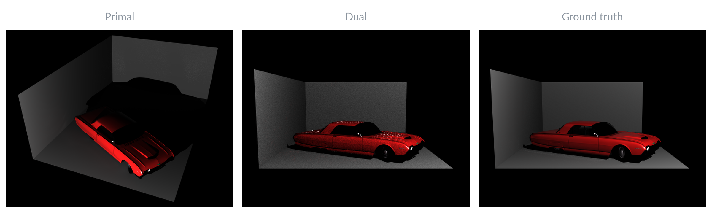

# Dual Photography in Mitsuba 3

Final project for MIT 6.4400 (Computer Graphics) by Adarsh Iyer and Tim Neumann.

A simulation of dual photography ([Sen et al., SIGGRAPH 2005](https://graphics.stanford.edu/papers/dual_photography/)) in [Mitsuba 3](https://www.mitsuba-renderer.org/). The primal image (left image above) shows a scene captured from the top right, with illumination from the bottom left. By capturing the light transport matrix **T** and using Helmholtz reciprocity, **Tᵀ** gives the *dual image*: the scene viewed from the projector, lit from the camera's position, without ever physically moving the light or camera (middle image above). To capture **T** efficiently, we implement adaptive multiplexing, which lights many non-overlapping projector blocks at once and needs only 777 patterns instead of the brute force 262,144 at 512 x 512 resolution.

## Setup

1. Install with `pip install -e .`, or `pip install -e ".[notebooks]"` to also get Jupyter. You need an NVIDIA GPU.
2. The car meshes aren't included since their license doesn't allow redistribution. You can download the [1961 Ford Thunderbird from Free3D](https://free3d.com/3d-model/ford-thinderbird-1961-re-uploaded-71607.html), split it into one `.obj` per material, and put the files in `assets/objs/sep_by_mtl/` (see `assets/car_scene.py` for the file names). You can also try the cube scene immediately or use your own model.
3. Run e.g. `CUDA_VISIBLE_DEVICES=0 python experiments/car_adaptive_script.py`. Results are written to `results/`.

## Files in this repo

| Path | Description |
|---|---|
| `sampling_algorithms/adaptive_multiplexing.py` | Adaptive multiplexing for measuring T |
| `utils/utils.py` | Image <-> vector helpers and Mitsuba render wrapper |
| `assets/car_scene.py` | The car scene in Mitsuba's format |
| `experiments/car_dual_script.py` | Brute-force on the car (takes a long time) |
| `experiments/car_adaptive_script.py` | Adaptive Multiplexing on the car (512 x 512, efficient), plus relighting |
| `notebooks/01`–`05` | Diagnostic cube scene (brute force, adaptive), then car (brute force, adaptive, relighting) |
| `results/` | Output images and GIFs |
